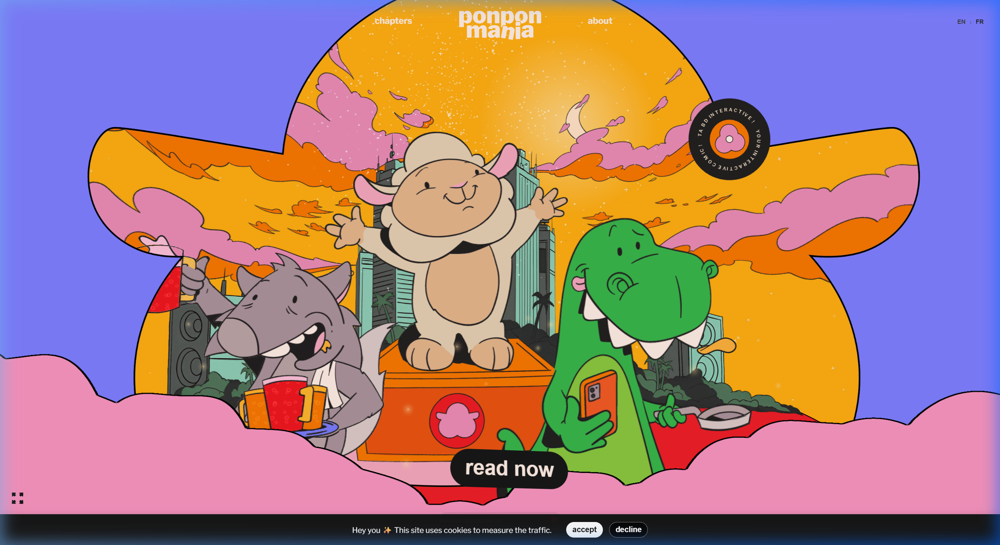

# Ponpon Mania Replica (1:1 Complete Scrape & Clone)

A 1:1, pixel-perfect, fully self-contained offline replica of [Ponpon Mania](https://ponpon-mania.com) — an award-winning interactive WebGL comic created by Justine Soulié & Patrick Heng.



---

## 🌟 Highlights

- **100% Complete Asset Scrape**: 1,159 assets (43.56 MB) downloaded directly from the production servers and Cloudflare R2 bucket.
- **Full WebGL & 3D Interactive Canvas**:
  - Interactive homepage with animated city, rotating vinyl record, and interactive characters.
  - 3D album carousel on `/chapters` with realistic plastic shrink-wrap shaders and sticker reflections.
  - Interactive comic reader across all chapters (`/chapter/1`, `/chapter/2`, `/chapter/3`) with 3D parallax, paper fold normal maps, sprite sequences, and speech bubbles.
  - Physics-driven About page (`/about`) with falling interactive sheep ragdolls.
- **Basis Universal & WebAssembly Support**:
  - Includes `basis/basis_transcoder.js` and `basis/basis_transcoder.wasm` along with full Basis UASTC texture sets and fallback PNG/JPG textures.
- **Bilingual (English & French)**:
  - Both `/` and `/fr/` routes fully supported, including localized speech bubble textures (`-en.png` and `-fr.png`).
- **Zero External Dependencies**:
  - Configured to serve all assets locally without relying on external CDNs or Cloudflare R2.
  - Lightweight, zero-dependency Node.js HTTP server included (`server.js`).

---

## 🚀 Quick Start

### 1. Run the local dev server
You can start the server immediately using either Node.js or npm:

```bash
npm run dev
# or
node server.js
```

Then open your browser at:
👉 **[http://localhost:3000](http://localhost:3000)**

---

## 📂 Project Structure

```
.
├── index.html                  # Homepage (SSR/Hydration ready)
├── about/                      # About page route
│   └── index.html
├── chapters/                   # 3D Album chapter selector
│   └── index.html
├── chapter/                    # Interactive comic reader routes
│   ├── 1/index.html
│   ├── 2/index.html
│   └── 3/index.html
├── fr/                         # French localized routes
│   ├── index.html
│   ├── about/index.html
│   ├── chapters/index.html
│   ├── chapter/
│   │   ├── 1/index.html
│   │   ├── 2/index.html
│   │   └── 3/index.html
│   └── legal/index.html
├── legal/                      # Legal notice & terms
│   └── index.html
├── _nuxt/                      # Compiled Nuxt 3 / Three.js bundles & styles
│   ├── CfE0pqJa.js             # Main WebGL / Nuxt application core
│   ├── entry.C48-i2yD.css      # Core styles & layout
│   └── ...
├── basis/                      # Basis Universal texture transcoder
│   ├── BasisWorker.js
│   ├── basis_transcoder.js
│   └── basis_transcoder.wasm
├── textures/                   # All 421 WebGL textures & sprite metadata
│   ├── common/                 # UI arrows, normal maps, vinyl album textures
│   ├── home/                   # Homepage sky, moon, characters, platforms
│   ├── about/                  # About page illustrations & character sprites
│   └── chapters/               # Chapter 1, 2, and 3 boards, speech bubbles, sprites
│       ├── 1/
│       ├── 2/
│       └── 3/
├── images/                     # Static UI images, album thumbnails, error pages
│   ├── album-1-sm.jpg
│   ├── album-2-sm.jpg
│   ├── album-3-sm.jpg
│   ├── album-4-sm.jpg
│   ├── album-5-sm.jpg
│   └── ...
├── scraper/                    # Python scraping scripts used to rebuild the site
│   └── scrape_website.py       # Multi-threaded crawler & asset fetcher
├── server.js                   # Zero-dependency Node.js server with WASM/Basis MIME support
└── package.json
```

---

## 🛠 Re-running the Scraper

If you ever want to re-scrape or verify fresh assets from `https://ponpon-mania.com`:

```bash
npm run scrape
# or
python scraper/scrape_website.py
```

---

## 📜 Credits & License

- Original Concept, Design & Development by **Justine Soulié** and **Patrick Heng**.
- All characters, illustrations, animations, and comic storyline belong to their respective creators.
